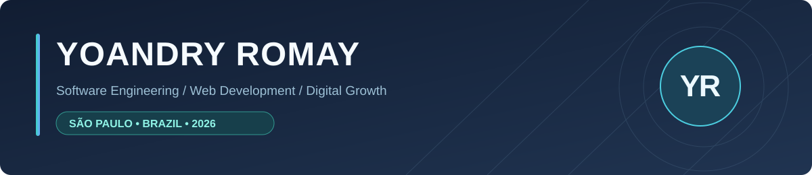
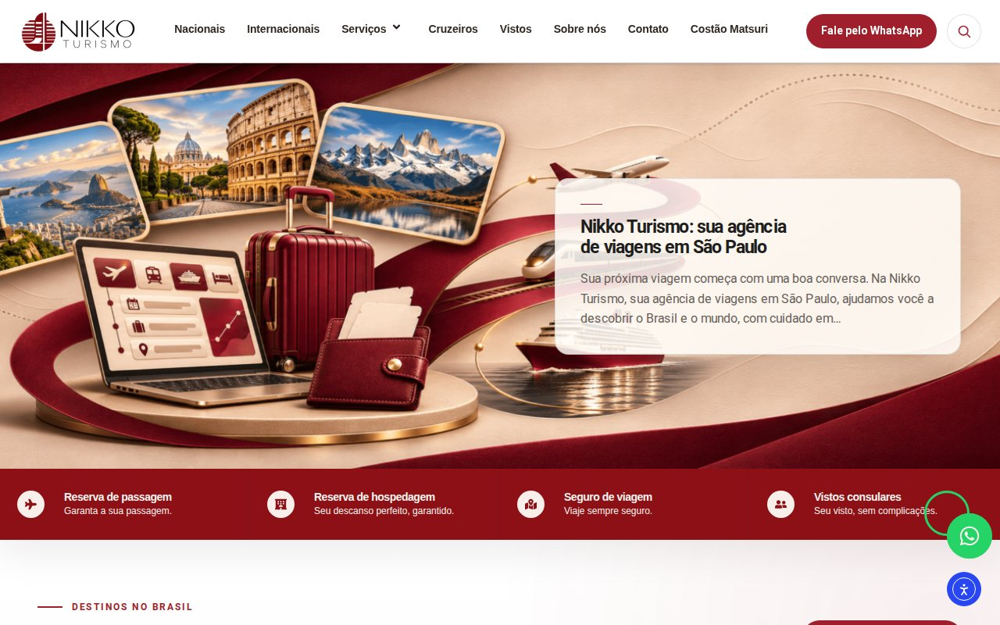
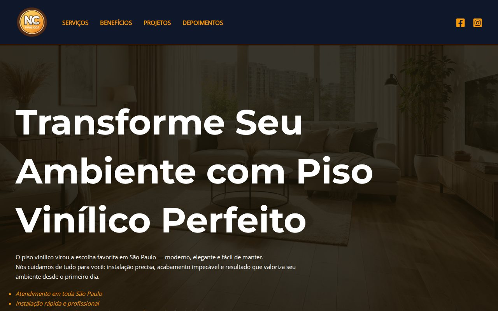
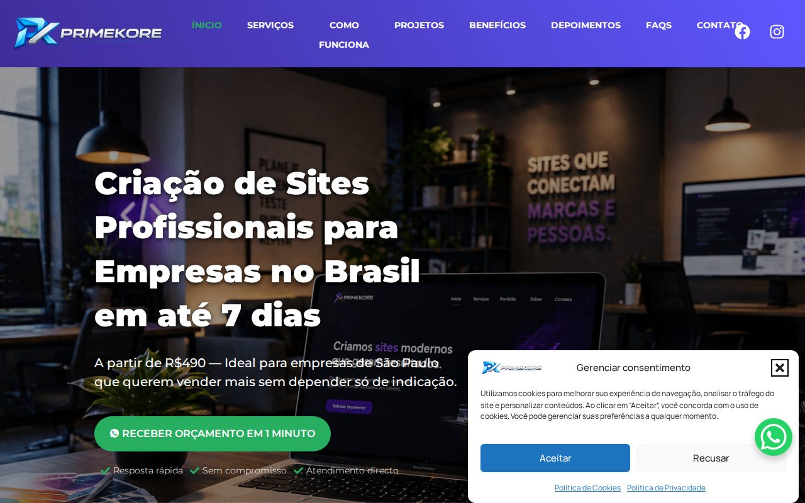
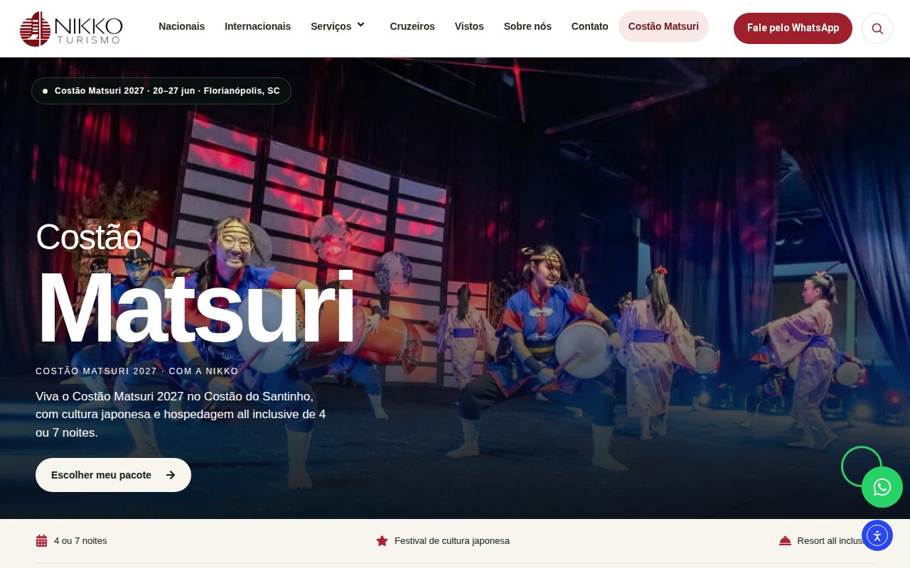

<a href="https://github.com/YoaRomay/YoaRomay/blob/main/README.md">Português</a> · <strong>English</strong> · <a href="https://github.com/YoaRomay/YoaRomay/blob/main/README.es.md">Español</a>

<strong>Software engineering, web development and digital strategy.</strong>

<a href="https://www.linkedin.com/in/yoandry-romay/">LinkedIn</a> · <a href="https://profiles.wordpress.org/yoaromay/">WordPress.org</a> · <a href="https://nikkoturismo.com.br/">Nikko Turismo</a>

I hold a Computer Science Engineering degree from UCI (Havana) and work at the intersection of web development, technical SEO, performance and digital acquisition. I currently work as a **Digital Marketing Analyst at Nikko Turismo**, in São Paulo, combining technical implementation with business goals.

## Selected projects
Real-world work focused on usability, maintainability, performance and lead generation.

<table>
<tr>
<td width="50%" valign="top">

<h3><a href="https://nikkoturismo.com.br/">Nikko Turismo</a></h3>

<strong>✦ MOST RECENT PROJECT · 2026</strong>

Travel agency website with a custom child theme, dynamic package templates, components and integrations.

<code>WordPress</code> <code>PHP</code> <code>ACF</code> <code>Elementor</code>

<a href="https://nikkoturismo.com.br/"><strong>Visit website →</strong></a>

</td>
<td width="50%" valign="top">

<h3><a href="https://ncvinilicos.com.br/">NC Vinílicos</a></h3>

Responsive vinyl-flooring services landing page focused on conversion and customer inquiries.

<code>WordPress</code> <code>SEO local</code> <code>UX</code> <code>WhatsApp</code>

<a href="https://ncvinilicos.com.br/"><strong>Visit website →</strong></a>

</td>
</tr>
<tr>
<td width="50%" valign="top">

<h3><a href="https://primekore.com.br/">PrimeKore</a></h3>

Digital presence development, services, visual identity and conversion-oriented content architecture.

<code>Web Design</code> <code>WordPress</code> <code>SEO</code> <code>Performance</code>

<a href="https://primekore.com.br/"><strong>Visit website →</strong></a>

</td>
<td width="50%" valign="top">

<h3><a href="https://nikkoturismo.com.br/costao-matsuri/">Costão Matsuri</a></h3>

Tourism campaign landing page designed to present the event and generate inquiries.

<code>Landing Page</code> <code>UX</code> <code>Marketing</code> <code>WordPress</code>

<a href="https://nikkoturismo.com.br/costao-matsuri/"><strong>Visit website →</strong></a>

</td>
</tr>
</table>

## Skills & tools

| Web development & architecture | Marketing, SEO & measurement |
| :--- | :--- |
| PHP · JavaScript · HTML5 · CSS3 · WordPress · Drupal 7–10 · Elementor · ACF · MySQL · PostgreSQL · Git | Technical & on-page SEO · Google Ads · GA4 · GTM · Search Console · Google Business Profile · Content strategy · Lead generation |
| Bootstrap · Twig · REST APIs · Linux · Composer · Drush · Web performance & accessibility | Keyword research · Photoshop · Illustrator · ChatGPT · Gemini · Copilot · Content automation |

## Professional experience

- **Sep. 2026–present · Nikko Turismo** — Digital Marketing Analyst, contributing to the travel agency's website development and improvements, SEO, content and campaign landing pages.
- **May 2025–present · Independent projects** — Digital content and social media; scripts, storytelling, branding, audience retention and organic-growth strategies for TikTok, YouTube, Facebook and Instagram.
- **Feb.–May 2026 · PrimeKore — Soluções Digitais** — Web Development and Marketing Specialist; websites, landing pages, online stores, SEO and project delivery for local businesses.
- **Jul. 2018–Feb. 2022 · XETID** — Web Development Specialist; Drupal institutional portals, technical SEO, accessibility, performance, responsive interfaces and API integrations.
- **Nov. 2017–Jul. 2018 · XETID** — Web Support and Development Specialist; Drupal website maintenance, bug fixes and functional improvements.

<strong>Institutional Drupal projects · MINCOM, Online Procedures, XETID and ACRC</strong>

- **[MINCOM Institutional Portal](https://www.mincom.gob.cu)** — Contributed to development and optimization of Cuba's Ministry of Communications website, including accessibility, technical SEO, performance and stability.
- **[MINCOM Online Procedures System](https://www.mincom.gob.cu/tramites)** — Contributed to online services, authentication and user-management features, architecture and usability.
- **[XETID Official Website](https://www.xetid.cu)** — Portal development and maintenance, feature updates, content architecture and web optimization.
- **ACRC Institutional Portal (2019)** — Contributed to front-end, responsive-design and content improvements.
- **Software quality (2019)** — Participated in the MINCOM portal quality-certification process conducted by the National Software Quality Center.

## Education, certifications & languages

**Computer Science Engineering** · Universidad de las Ciencias Informáticas (UCI), Havana · **Sep. 2010–Jun. 2015**.  
**EF SET English Certificate** · **61/100 (C1 on the test, 2022)** · [View certificate](https://www.efset.org/cert/1CibFk).  
**Languages (self-reported in résumé):** Spanish C2 (native) · Portuguese B1 · English B1 · Russian A1.

Self-reported language proficiency is shown separately from the EF SET test result.

### Independent development

**Contextual Media SEO** — an independent WordPress plugin for reviewing image metadata and contextual image usage, with interfaces in Portuguese, English and Spanish. Source code remains private.

### Content & community

[El Narrador del Velo](https://www.tiktok.com/@elnarradordelvelo) — an independent storytelling and organic community-building project.

## Let's connect

<a href="https://www.linkedin.com/in/yoandry-romay/"><strong>LinkedIn</strong></a> · <a href="https://github.com/YoaRomay"><strong>GitHub</strong></a> · <a href="https://profiles.wordpress.org/yoaromay/"><strong>WordPress.org</strong></a>

Professional repositories remain private where appropriate. The images above are screenshots of public websites.
