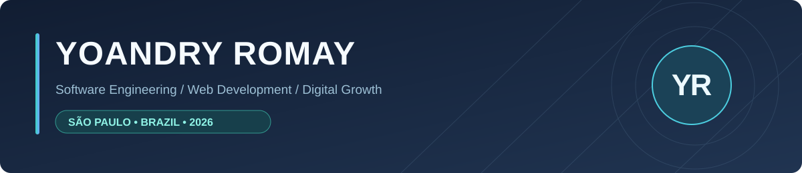
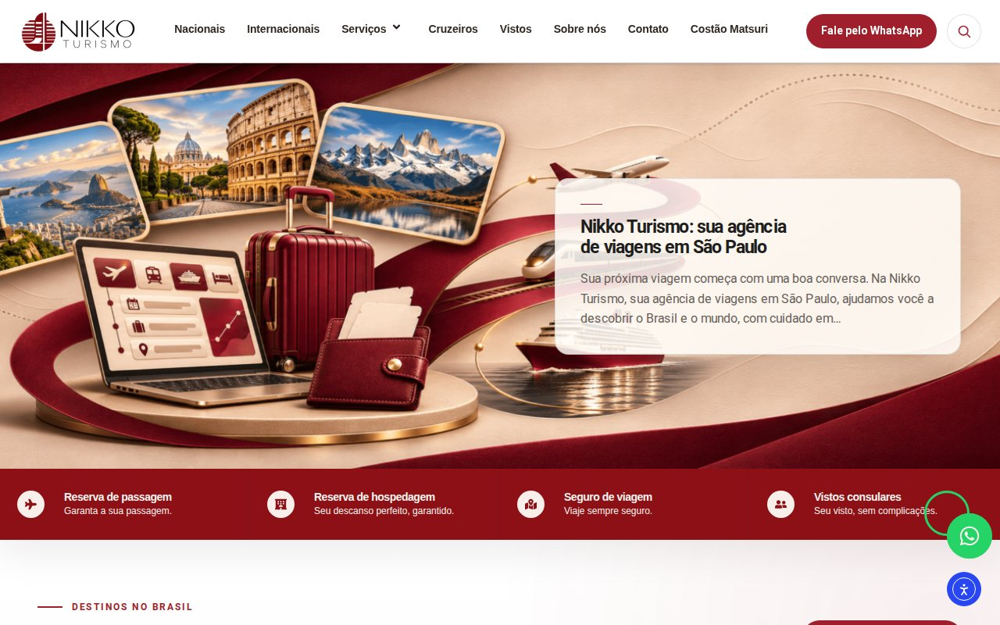
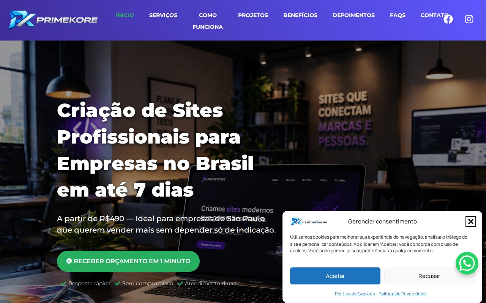
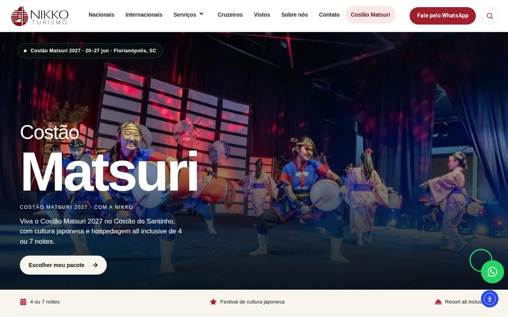

[Português](README.md) · [English](README.en.md) · **Español**

<strong>Ingeniería de software, desarrollo web y estrategia digital.</strong>

<a href="https://www.linkedin.com/in/yoandry-romay/">LinkedIn</a> · <a href="https://profiles.wordpress.org/yoaromay/">WordPress.org</a> · <a href="https://nikkoturismo.com.br/">Nikko Turismo</a>

Soy graduado en Ingeniería en Ciencias Informáticas por la UCI (La Habana) y trabajo en la intersección del desarrollo web, SEO técnico, rendimiento y adquisición digital. Actualmente soy **Analista de Marketing Digital en Nikko Turismo**, en São Paulo, combinando implementación técnica con objetivos de negocio.

## Proyectos seleccionados
Trabajos reales enfocados en experiencia de usuario, mantenibilidad, rendimiento y captación de clientes.

<table>
<tr>
<td width="50%" valign="top">

<h3><a href="https://nikkoturismo.com.br/">Nikko Turismo</a></h3>

<strong>✦ PROYECTO MÁS RECIENTE · 2026</strong>

Sitio de agencia de viajes con tema hijo personalizado, plantillas dinámicas de paquetes, componentes e integraciones.

<code>WordPress</code> <code>PHP</code> <code>ACF</code> <code>Elementor</code>

<a href="https://nikkoturismo.com.br/"><strong>Visitar sitio →</strong></a>

</td>
<td width="50%" valign="top">

<h3><a href="https://ncvinilicos.com.br/">NC Vinílicos</a></h3>

Landing page adaptable para servicios de pisos vinílicos, orientada a conversión y contacto comercial.

<code>WordPress</code> <code>SEO local</code> <code>UX</code> <code>WhatsApp</code>

<a href="https://ncvinilicos.com.br/"><strong>Visitar sitio →</strong></a>

</td>
</tr>
<tr>
<td width="50%" valign="top">

<h3><a href="https://primekore.com.br/">PrimeKore</a></h3>

Desarrollo de la presencia digital, servicios, identidad visual y arquitectura de contenidos para captación.

<code>Web Design</code> <code>WordPress</code> <code>SEO</code> <code>Performance</code>

<a href="https://primekore.com.br/"><strong>Visitar sitio →</strong></a>

</td>
<td width="50%" valign="top">

<h3><a href="https://nikkoturismo.com.br/costao-matsuri/">Costão Matsuri</a></h3>

Landing page de campaña turística diseñada para presentar el evento y captar interesados.

<code>Landing Page</code> <code>UX</code> <code>Marketing</code> <code>WordPress</code>

<a href="https://nikkoturismo.com.br/costao-matsuri/"><strong>Visitar sitio →</strong></a>

</td>
</tr>
</table>

## Competencias y herramientas

| Desarrollo y arquitectura web | Marketing, SEO y medición |
| :--- | :--- |
| PHP · JavaScript · HTML · CSS · WordPress · Drupal · Elementor · ACF · MySQL · PostgreSQL · Git | SEO técnico · SEO on-page · Google Ads · GA4 · Google Tag Manager · Search Console · Google Business Profile · UX · Conversão |

## Experiencia profesional

- **2026–actualidad · Nikko Turismo** — Analista de Marketing Digital; desarrollo y evolución del sitio de la agencia, landing pages de campañas y experiencias digitales.
- **2026 · PrimeKore — Soluções Digitais** — Desarrollo de sitios web y landing pages, SEO y soluciones digitales para pequeños negocios.
- **2017–2022 · XETID, Cuba** — Soporte y desarrollo web, con participación en proyectos institucionales realizados con Drupal.

<strong>Experiencia técnica anterior: Drupal y proyectos institucionales (2019–2022)</strong>

- **MINCOM · Sistema de Trámites Online (2019–2022):** participación en desarrollo, mantenimiento y mejoras de usabilidad, contenido y adaptabilidad.
- **XETID · Portal Institucional (2019–2020):** mantenimiento, mejoras front-end, adaptabilidad y rendimiento.
- **MINCOM · Portal Institucional (2019–2020):** SEO técnico, navegación, rendimiento y organización del contenido.
- **ACRC · Portal Institucional (2019):** mejoras front-end, contenidos y adaptabilidad.
- **Certificación de calidad del portal MINCOM (2019):** participación en el proceso de certificación técnica.

## Formación e idiomas

**Ingeniería en Ciencias Informáticas** · Universidad de las Ciencias Informáticas, La Habana (**2010–2015**).  
**EF SET English Certificate** · 61/100 (**C1 Advanced**, mayo de 2022).  
**Idiomas:** español (nativo), portugués (avanzado), inglés (competencia profesional).

### Desarrollo independiente

**Contextual Media SEO** — plugin independiente para WordPress que revisa metadatos y usos contextuales de imágenes, con interfaz en portugués, inglés y español. El código fuente sigue siendo privado.

### Contenido y comunidad

[El Narrador del Velo](https://www.tiktok.com/@elnarradordelvelo) — proyecto propio de storytelling y crecimiento orgánico.

## Conectemos

<a href="https://www.linkedin.com/in/yoandry-romay/"><strong>LinkedIn</strong></a> · <a href="https://github.com/YoaRomay"><strong>GitHub</strong></a> · <a href="https://profiles.wordpress.org/yoaromay/"><strong>WordPress.org</strong></a>

Los repositorios profesionales permanecen privados cuando corresponde. Las imágenes anteriores son capturas de sitios públicos.
