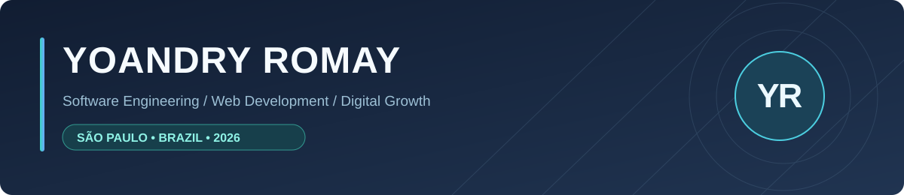
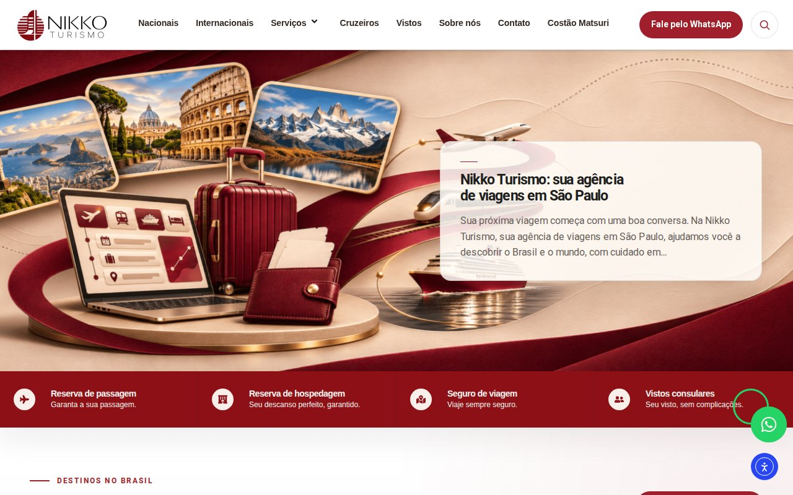
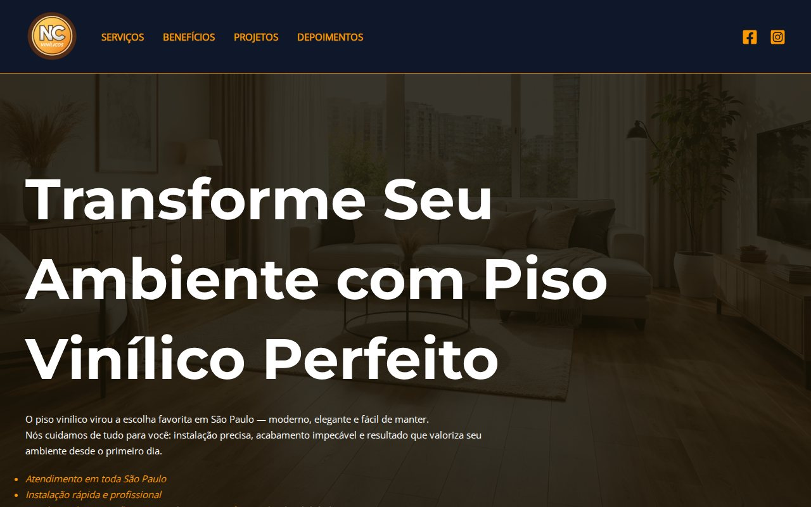
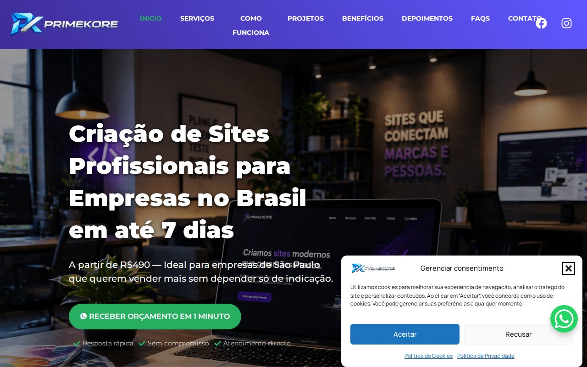
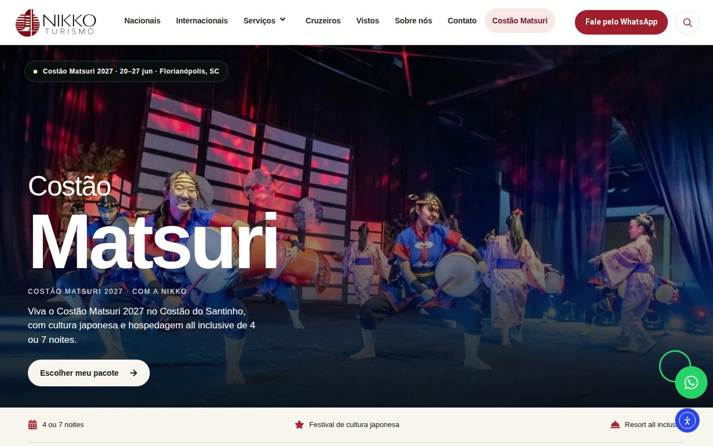

<strong>Português</strong> · <a href="https://github.com/YoaRomay/YoaRomay/blob/main/README.en.md">English</a> · <a href="https://github.com/YoaRomay/YoaRomay/blob/main/README.es.md">Español</a>

<strong>Engenharia de software, desenvolvimento web e estratégia digital.</strong>

<a href="https://www.linkedin.com/in/yoandry-romay/">LinkedIn</a> · <a href="https://profiles.wordpress.org/yoaromay/">WordPress.org</a> · <a href="https://nikkoturismo.com.br/">Nikko Turismo</a>

Sou formado em Engenharia em Ciências Informáticas pela UCI (Havana) e atuo na interseção entre desenvolvimento web, SEO técnico, performance e aquisição digital. Hoje trabalho como **Analista de Marketing Digital na Nikko Turismo**, em São Paulo, combinando implementação técnica com objetivos de negócio.

## Projetos selecionados
Projetos reais, com foco em experiência de uso, manutenção, performance e geração de oportunidades.

<table>
<tr>
<td width="50%" valign="top">

<h3><a href="https://nikkoturismo.com.br/">Nikko Turismo</a></h3>

<strong>✦ PROJETO MAIS RECENTE · 2026</strong>

Site da agência de viagens, com tema filho, templates dinâmicos de pacotes turísticos, componentes e integrações próprias.

<code>WordPress</code> <code>PHP</code> <code>ACF</code> <code>Elementor</code>

<a href="https://nikkoturismo.com.br/"><strong>Acessar site →</strong></a>

</td>
<td width="50%" valign="top">

<h3><a href="https://ncvinilicos.com.br/">NC Vinílicos</a></h3>

Landing page responsiva para serviços de pisos vinílicos, orientada à conversão e ao contato comercial.

<code>WordPress</code> <code>SEO local</code> <code>UX</code> <code>WhatsApp</code>

<a href="https://ncvinilicos.com.br/"><strong>Acessar site →</strong></a>

</td>
</tr>
<tr>
<td width="50%" valign="top">

<h3><a href="https://primekore.com.br/">PrimeKore</a></h3>

Desenvolvimento completo da presença digital, serviços, identidade visual e estrutura de conteúdo para captação.

<code>Web Design</code> <code>WordPress</code> <code>SEO</code> <code>Performance</code>

<a href="https://primekore.com.br/"><strong>Acessar site →</strong></a>

</td>
<td width="50%" valign="top">

<h3><a href="https://nikkoturismo.com.br/costao-matsuri/">Costão Matsuri</a></h3>

Página de campanha turística criada para apresentar o evento e estimular solicitações comerciais.

<code>Landing Page</code> <code>UX</code> <code>Marketing</code> <code>WordPress</code>

<a href="https://nikkoturismo.com.br/costao-matsuri/"><strong>Acessar site →</strong></a>

</td>
</tr>
</table>

## Competências e ferramentas

| Desenvolvimento e arquitetura web | Marketing, SEO e mensuração |
| :--- | :--- |
| PHP · JavaScript · HTML5 · CSS3 · WordPress · Drupal 7–10 · Elementor · ACF · MySQL · PostgreSQL · Git | SEO técnico · SEO on-page · Google Ads · GA4 · GTM · Search Console · Google Business Profile · Estratégia de conteúdo · Geração de leads |
| Bootstrap · Twig · APIs REST · Linux · Composer · Drush · Performance e acessibilidade web | Pesquisa de palavras-chave · Photoshop · Illustrator · ChatGPT · Gemini · Copilot · Automação de conteúdo |

## Experiência profissional

- **set. 2026–atual · Nikko Turismo** — Analista de Marketing Digital, com atuação no desenvolvimento e evolução do site da agência, SEO, conteúdo e páginas de campanhas.
- **mai. 2025–atual · Projetos independentes** — Conteúdo digital e social media; roteiros, storytelling, branding e estratégias de retenção e crescimento orgânico para TikTok, YouTube, Facebook e Instagram.
- **fev.–mai. 2026 · PrimeKore — Soluções Digitais** — Especialista em Desenvolvimento Web e Marketing; websites, landing pages, lojas virtuais, SEO e gestão de projetos digitais para negócios locais.
- **jul. 2018–fev. 2022 · XETID** — Especialista em Desenvolvimento Web; portais institucionais em Drupal, SEO técnico, acessibilidade, performance, interfaces responsivas e integrações de APIs.
- **nov. 2017–jul. 2018 · XETID** — Especialista em Suporte e Desenvolvimento Web; manutenção de portais Drupal, correção de bugs e melhorias funcionais.

<strong>Projetos institucionais em Drupal · MINCOM, Trâmites Online, XETID e ACRC</strong>

- **[Portal Institucional do MINCOM](https://www.mincom.gob.cu)** — Participação no desenvolvimento e otimização do portal do Ministério das Comunicações de Cuba: acessibilidade, SEO técnico, performance e estabilidade.
- **[Sistema de Trâmites Online — MINCOM](https://www.mincom.gob.cu/tramites)** — Participação no desenvolvimento de serviços digitais, funcionalidades de autenticação e gestão de usuários, arquitetura e usabilidade.
- **[Site Oficial da XETID](https://www.xetid.cu)** — Desenvolvimento e manutenção do portal institucional, atualização de funcionalidades, organização de conteúdo e otimização web.
- **Portal Institucional da ACRC (2019)** — Participação em melhorias front-end, responsividade e organização de conteúdo.
- **Qualidade de software (2019)** — Participação no processo de certificação de qualidade do portal oficial do MINCOM pelo Centro Nacional de Qualidade de Software.

## Formação, certificações e idiomas

**Engenharia em Ciências Informáticas** · Universidad de las Ciencias Informáticas (UCI), Havana · **set. 2010–jun. 2015**.  
**Certificação EF SET de inglês** · **61/100 (C1 no teste, 2022)** · [Ver certificado](https://www.efset.org/cert/1CibFk).  
**Idiomas (níveis declarados no currículo):** espanhol C2 (nativo) · português B1 · inglês B1 · russo A1.

Os níveis declarados de uso dos idiomas são apresentados separadamente do resultado do exame EF SET.

### Desenvolvimento autoral

**Contextual Media SEO** — plugin WordPress independente para revisar metadados de imagens e usos contextuais, com interface em português, inglês e espanhol. O código-fonte permanece privado.

### Conteúdo & comunidade

[El Narrador del Velo](https://www.tiktok.com/@elnarradordelvelo) — projeto próprio de storytelling e crescimento orgânico.

## Conecte-se comigo

<a href="https://www.linkedin.com/in/yoandry-romay/"><strong>LinkedIn</strong></a> · <a href="https://github.com/YoaRomay"><strong>GitHub</strong></a> · <a href="https://profiles.wordpress.org/yoaromay/"><strong>WordPress.org</strong></a>

Os repositórios profissionais permanecem privados quando necessário. As imagens acima são capturas dos sites públicos.
